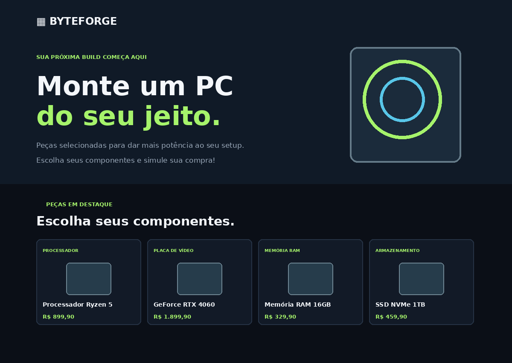

# ByteForge — Loja de peças para PC

**Aluno(a):** SEU NOME AQUI  
**Trilha:** Desenvolvimento Web  
**Projeto:** Desafio 1 — Minha Loja: Simulador de Compras

## Sobre a loja

A ByteForge é uma loja fictícia de componentes para computadores. A página apresenta quatro peças para quem deseja montar ou atualizar um PC:

| Produto | Preço |
|---|---:|
| Processador Ryzen 5 | R$ 899,90 |
| GeForce RTX 4060 | R$ 1.899,90 |
| Memória RAM 16GB | R$ 329,90 |
| SSD NVMe 1TB | R$ 459,90 |

A simulação concede **10% de desconto para compras com subtotal igual ou superior a R$ 1.500,00**. Os valores e a regra de desconto são fictícios e usados apenas para a atividade.

## Tecnologias utilizadas

- **HTML:** estrutura e conteúdo da página.
- **CSS:** cores, organização, cartões dos produtos e adaptação para telas menores.
- **JavaScript:** perguntas de quantidade, conversão com `Number()`, cálculos, validação e exibição do resultado com `alert()`.

## Como executar

1. Baixe ou clone este repositório.
2. Abra a pasta do projeto.
3. Abra o arquivo `index.html` em um navegador.
4. Clique em **Simular compra** e informe as quantidades solicitadas.
5. Digite `0` quando não quiser comprar determinado produto.

Não é necessário instalar programas ou bibliotecas.

## Captura de tela

> A imagem incluída é uma prévia visual. Antes de entregar, abra o `index.html` no navegador, tire uma captura de tela da página e substitua este arquivo por ela, mantendo o nome `captura-da-loja.png`.

## Testes realizados

- Informar `0` para todos os produtos: a página informa que nenhum produto foi selecionado.
- Comprar uma unidade de Memória RAM: o resumo mostra a quantidade e o valor de R$ 329,90.
- Comprar uma unidade de GeForce RTX 4060: o sistema aplica o desconto de 10%.
- Informar uma quantidade negativa ou um valor que não seja numérico: o sistema avisa que a quantidade é inválida.

## Dificuldade encontrada e aprendizado

Uma dificuldade foi organizar os cálculos e verificar quando o desconto deveria ser aplicado. Aprendi a utilizar `prompt()` para receber informações, `Number()` para converter as respostas em números, variáveis para guardar os valores e condições (`if`) para verificar o desconto.

## Uso de inteligência artificial

A inteligência artificial foi utilizada como apoio para organizar a estrutura inicial do projeto, sugerir a identidade visual e revisar partes do código. O projeto deve ser estudado e adaptado pelo aluno. É importante testar a simulação e conseguir explicar o funcionamento das variáveis, dos cálculos e das condições utilizadas.
